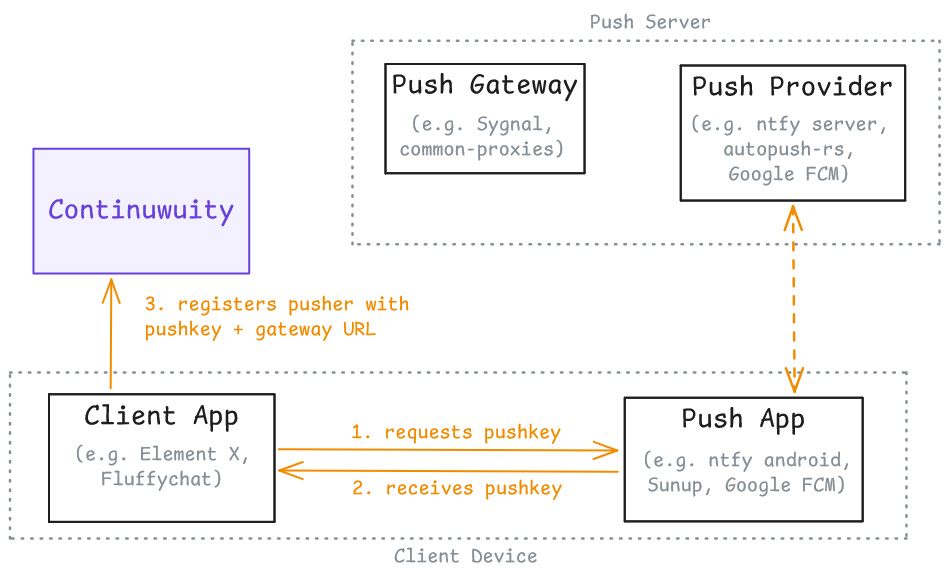
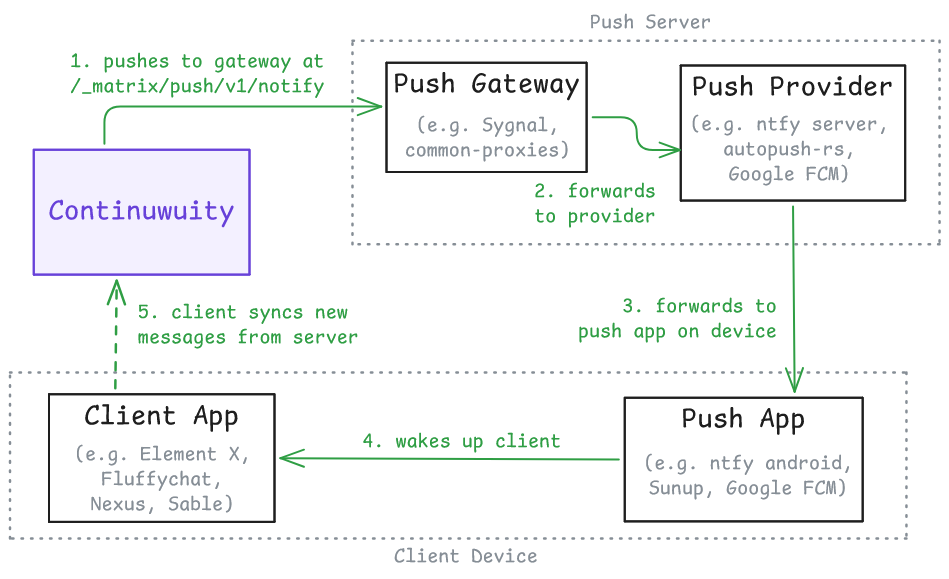
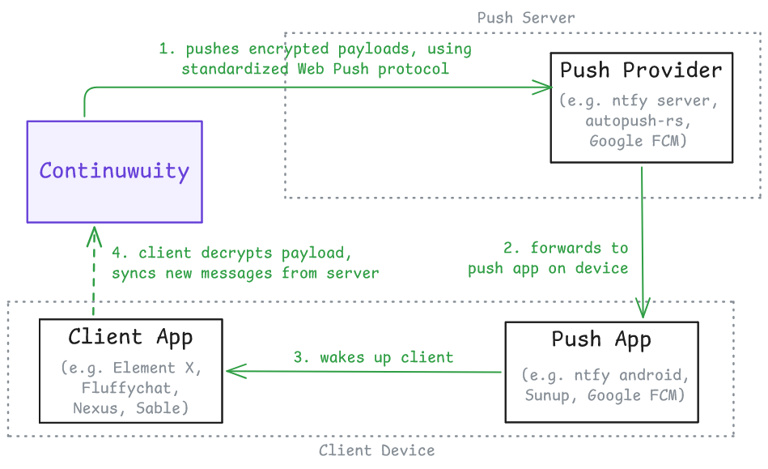

import { Tab, Tabs } from '@rspress/core/theme';

# Push notifications

Matrix clients receive notifications in the following ways:

- **In-band notifications**, which are shown when the client actively syncs with the server.
- **Push notifications**, which are posted by the server via an external push service to the client. This is commonly used for mobile devices to receive out-of-band notifications, and is the focal topic of this page.

Generally, push notifications work out-of-the-box with your mobile device's preconfigured setup. The details below are useful for advanced use cases, such as when using an alternative push backend (e.g. UnifiedPush) or selfhosting your own.

## Overview

Continuwuity supports two push methods: using the legacy **Matrix Push Gateway** and the new **Web Push protocol**. The former method is currently supported by more clients, but the latter enables push notifications to be end-to-end-encrypted. They work as follows:

<Tabs groupId="push-ops">
<Tab label="Registration">


A client registers a pusher with Continuwuity with the the following details supplied:

- The _pushkey_, which is a unique target URL provided by the push backend that the client hooks up to.
- (For Push Gateway method only) The _push gateway_ URL, which is [provided by the client](#push-gateways).
- (For Web Push method only) Some _encryption details_ generated by the client, so the server knows how to encrypt its push payloads.

</Tab>

<Tab label="Operation (Push Gateway)">


Continuwuity pushes messages to the push gateway, which then converts it into a suitable format and forwards it to the push provider server and then the push app. This push app then wakes up the client to fetch new message(s) from Continuwuity.

Finally, the client calculates, against a set of _push rules_, to determine whether the fetched message(s) should be notified to users or not.

</Tab>

<Tab label="Operation (Web Push)">


Continuwuity pushes encrypted messages to the push provider, which then forwards it to the push app and then the client. The client then wakes up to decrypt this push content, and if needed, fetches the full message from the server.

Finally, the client calculates, against a set of _push rules_, to determine whether the pushed message(s) should be notified to users or not.

</Tab>

</Tabs>

_([excalidraw file of the diagrams](/guides/push-notifications.excalidraw))_

Therefore, Continuwuity's role within this system is to keep track of client-registered _pushers_ and send relevant payloads to them. To view and manage these pushers, use the [`!admin query pusher`](../reference/admin/query.md#admin-query-pusher) set of commands.

### Push Gateways

The push gateway URL is usually pre-configured by the app. However, some clients (such as Element X) implements [Gateway Discovery], and attempts to detect a push gateway _on the same domain as the push provider_, before falling back to a hardcoded one.

As per the [spec][spec-push-gateway-api], these push gateways must be available on the `/_matrix/push/v1/notify` path of said domain. To test that a push gateway is accessible by the homeserver, make a request for it from the homeserver's IP:

```txt
curl https://push.example.com/_matrix/push/v1/notify
{"unifiedpush":{"gateway":"matrix"}}
```

[Gateway Discovery]: https://unifiedpush.org/users/gateway/#discovery--hosting

### Web Push

Continuwuity implements Web Push according to [MSC4174], which generally works out of the box with most push providers. Note that this mechanism does not require a push gateway component.

[MSC4174]: https://github.com/matrix-org/matrix-spec-proposals/pull/4174

## UnifiedPush

[UnifiedPush][unifiedpush] is a decentralized, open notifications system on Android and Linux that is supported by many Matrix clients. It is compatible with both the Web Push and Push Gateway mechanisms, and therefore requires no additional setup from the homeserver.

:::info Debugging UnifiedPush
To debug and test your UnifiedPush installation, use the [UP-Example] app for Android and the [UnifiedPush Troubleshooter] app for Linux distributions.
:::

Below are notes for some known UnifiedPush distributors.

[unifiedpush]: https://unifiedpush.org
[UP-Example]: https://codeberg.org/UnifiedPush/android-example
[UnifiedPush Troubleshooter]: https://flathub.org/en/apps/org.unifiedpush.Troubleshooter

### ntfy

[ntfy][ntfy] is an easy-to-install push application, and has plenty of publicly available instances. Its server can also be selfhosted and includes an embedded Matrix push gateway.

Some tutorials on selfhosting ntfy can be found below:

- [Official ntfy self-hosting tutorial][official-ntfy-selfhosting]
- [Element's tutorial on Unified Push and ntfy][element-ntfy]

:::warning Avoid ntfy.sh
Avoid using the `https://ntfy.sh` push server, which is configured as the default in the ntfy app. This server is known to ratelimit requests aggressively.
:::

[ntfy]: https://ntfy.sh
[element-ntfy]: https://docs.element.io/latest/element-support/element-androidios-client-settings/using-unified-push-and-ntfy-for-push-notifications/
[official-ntfy-selfhosting]: https://docs.ntfy.sh/install/

### Other UnifiedPush distributors

To find a list of other UnifiedPush distributors, visit this [page][unifiedpush-distributors].

[unifiedpush-distributors]: https://unifiedpush.org/users/distributors/

Community tutorials for selfhosting some of these stacks can be found below. Unless stated otherwise, they are all tested against Element X Android and the push gateway mechanism (but should be fine with Web Push as well).

- [Self-hosting Sunup for Matrix and UnifiedPush][kimiblock-selfhosting-sunup], by Kimiblock.
    - Push gateway: [common-proxies]
    - Push server: [autopush-rs]
    - Push app: [Sunup][sunup]
- [Matrix notifications on Android, powered by XMPP][stratself-xmpp], by stratself.
    - Push gateway: [common-proxies]
    - Push server: [ejabberd's mod_unified_push]
    - Push app: [Conversations] (and forks)
- [Element X push notifications via Conversations][alfredolin-xmpp], by Alfredo Lin.
    - Push gateway: [common-proxies]
    - Push server: [Prosody's mod_unified_push]
    - Push app: [Conversations]
- Nextcloud's NextPush flow, which uses the following stack:
    - Push server + push gateway: [uppush] (selfhosting tutorial included)
    - Push app: [NextPush Android]

[kimiblock-selfhosting-sunup]: https://blog.kimiblock.top/2025/09/11/selfhosting-sunup/
[stratself-xmpp]: https://muoi.me/~stratself/articles/matrix-notifs-xmpp
[alfredolin-xmpp]: https://alfredolin.eu/blog/2026/07/24/element-x-push-notifications-via-conversations/
[common-proxies]: https://codeberg.org/UnifiedPush/common-proxies/
[sunup]: https://codeberg.org/Sunup/android
[autopush-rs]: https://github.com/mozilla-services/autopush-rs
[ejabberd's mod_unified_push]: https://github.com/processone/ejabberd-contrib/tree/master/mod_unified_push
[Prosody's mod_unified_push]: https://modules.prosody.im/mod_unified_push
[Conversations]: https://conversations.im
[uppush]: https://codeberg.org/NextPush/uppush
[NextPush Android]: https://codeberg.org/NextPush/nextpush-android

## Troubleshooting

Issues with push can arise due to other components of the system that is not your homeserver (for example, the connection fails between the push gateway and the push server). Make sure you check the logs of these components for debugging as well.

### Locally hosted push gateways / push providers

Outbound requests, including push notifications, follows the `ip_range_denylist` config option which refuses loopback and private-range destinations by default. This would break against push components that are self-hosted on a LAN address, and will result in these log entries at push creation time:

```txt
WARN conduwuit_service::pusher: Pusher URL is a forbidden remote address url=https://push.example.com/_matrix/push/v1/notify
```

To fix this, configure `ip_range_denylist` to exclude your push gateway or push server's address from the array, and restart Continuwuity to apply the changes.

### Push notifications not making sounds/not being seen

This is likely an issue with one's _push rules_, which determines what events are shown to users as notifications. Check your push rules in the clients' notifications settings and tweak accordingly. Continuwuity also provides an [`!admin users reset-push-rules`](../reference/admin/users#admin-users-reset-push-rules) command, which restores the rules to the default of notifying for every message.

Another potential reason may be that background services for push are being frequently terminated by your operating system, a [well-known problem][dontkillmyapp] with many Android-based devices. To fix this, follow your operating system's instructions to allow your Push App to be exempt from background restrictions.

Otherwise, if you find Continuwuity not sending push notifications according to the spec, feel free to discuss in our [support room][support-room] or open an issue.

[dontkillmyapp]: https://dontkillmyapp.com
[support-room]: https://matrix.to/#/#continuwuity:continuwuity.org?via=continuwuity.org&via=ellis.link&via=explodie.org&via=matrix.org

### Various "Could not send request to pusher" log entries

If you find spurious log entries like this in your Continuwuity deployment:

```txt
WARN push{user_id="@user:example.com" pushkey="very-long-string-of-letters" events=1}:send_push_notice:send_notice:send_request: conduwuit_service::pusher: Could not send request to pusher https//push.example.com: error sending request for url (https://push.example.com/_matrix/push/v1/notify)
```

Then, your server is most likely sending push requests to too many invalid targets. This could be due to one of the following reasons:

#### Connection issues between the server and the push gateway

Verify that connection to the push gateway is working correctly, which may include checking firewall rules, DNS, and that the push gateway is online. The section on [locally-hosted gateways/push providers](#locally-hosted-push-gateways--push-providers) may also apply to you.

#### Expired push endpoints

Active Matrix clients periodically renew their pushkeys as the old ones expire, and consequently register them against Continuwuity. As these pushers build up over time, the homeserver will keep sending more requests to an increasing number of "dead" push endpoints. This results in the errors seen above, and can heavily impact performance if not mitigated.

To work around this issue, the following actions can be made:

- Delete all pushers of a user with the [`!admin query pusher delete-all-user`](../reference/admin/query##admin-query-pusher-delete-all-user) command. This command is generally not very disruptive, as active clients will re-register new pushers the next time they log on.
- Alternatively, delete one's own pushers from a client that supports doing so. Currently this only includes FluffyChat and Element Classic/SchildiChat Legacy.

While clients are supposed to automatically delete old pushers under their own control, this behaviour has not been observed extensively. A further discussion of this issue can be found in [#2242][issue-2242].

[issue-2242]: https://forgejo.ellis.link/continuwuation/continuwuity/issues/2242

## Related Documentation

Specifications:

- [Matrix specification for the Push Gateway API][spec-push-gateway-api]
- [Matrix Client-Server API for push notifications][spec-c-s-push-notifications]
- [UnifiedPush specifications][unifiedpush-spec]
- [MSC4174: Web push][MSC4174]
- [Web Push RFCs][webpush-rfcs]

Other:

- [Matrix Push Rules and Notifications][clokep-push] - blogpost on push rules in Matrix

[webpush-rfcs]: https://datatracker.ietf.org/wg/webpush/documents/
[spec-push-gateway-api]: https://spec.matrix.org/latest/push-gateway-api/
[spec-c-s-push-notifications]: https://spec.matrix.org/latest/client-server-api/#push-notifications
[unifiedpush-spec]: https://unifiedpush.org/developers/spec/definitions/
[clokep-push]: https://patrick.cloke.us/posts/2023/05/08/matrix-push-rules-notifications/
