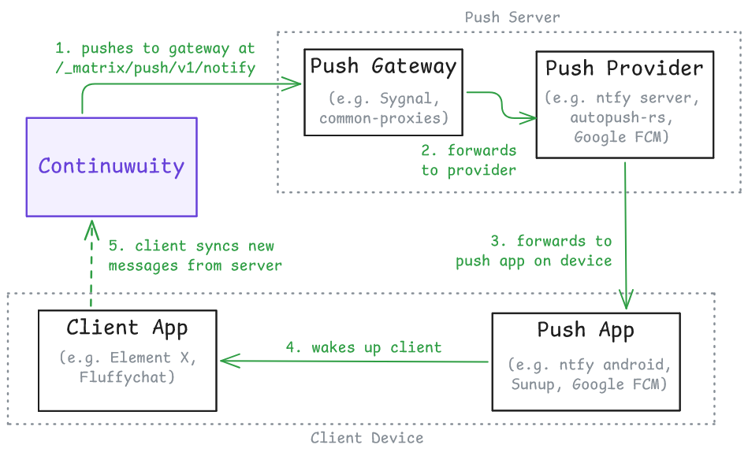

import { Tab, Tabs } from '@rspress/core/theme';

# Push notifications

Matrix clients receive notifications in the following ways:

- **In-band notifications**, which are retrieved when the client actively syncs with the server.
- **Push notifications**, which are posted by the server via an external push service to the client. This is commonly used for mobile devices to receive out-of-band notifications.

This page is concerned with the latter use case.

## Overview

The push system works as follows:

<Tabs groupId="push-ops">
<Tab label="Registration">


_([excalidraw file of the diagrams](./push-notifications.excalidraw))_

A client registers a pusher with Continuwuity, bringing its own pushkey and push gateway URL.

- The pushkey is a unique target URL, provided by the push backend that the client hooks up to.
- The [push gateway][spec-push-gateway-api] URL is usually pre-configured by the app. However, some clients (such as Element X) attempts to detect a push gateway on the _same URL as the push provider_ and use it, before falling back to a hardcoded one.

</Tab>

<Tab label="Operation">


_([excalidraw file of the diagrams](./push-notifications.excalidraw))_

Continuwuity pushes messages to the push gateway, which then converts it into a suitable format and forwards it to the push provider server and then the push app. This push app then wakes up the client to fetch new messages from Continuwuity.

Finally, the client calculates, against a set of _push rules_, to determine whether the fetched message should be notified to users or not.
</Tab>

</Tabs>

Therefore, Continuwuity's role within this system is to keep track of client-registered pushers and send relevant payloads via their configured push gateway. To view and manage these pushers, use the [`!admin query pusher`](../reference/admin/query.md#admin-query-pusher) set of commands.

## UnifiedPush

[UnifiedPush][unifiedpush] is an open and decentralised push system that is commonly used on Android as an alternative to Google's proprietary Firebase backend. It generally works well with Continuwuity and is supported by a wide range of Android Matrix clients.

[unifiedpush]: https://unifiedpush.org

### ntfy

[ntfy][ntfy] is an easy-to-install push application, and has plenty of publicly available instances. Its server can also be selfhosted and includes an embedded Matrix push gateway.

Some tutorials on selfhosting ntfy can be found below:

- [Element's tutorial on Unified Push and ntfy][element-ntfy]
- [Official ntfy self-hosting tutorial][official-ntfy-selfhosting]

:::warning Avoid using ntfy.sh
Avoid using the `https://ntfy.sh` push server, which is configured as a default in the ntfy app. This server is known to ratelimit Matrix notifications aggressively.
:::

[ntfy]: https://ntfy.sh
[element-ntfy]: https://docs.element.io/latest/element-support/element-androidios-client-settings/using-unified-push-and-ntfy-for-push-notifications/
[official-ntfy-selfhosting]: https://docs.ntfy.sh/install/

### Other UnifiedPush distributors

To find a list of UnifiedPush distributors, visit this [page][unifiedpush-distributors].

[unifiedpush-distributors]: https://unifiedpush.org/users/distributors/

Community tutorials for selfhosting some of these UnifiedPush stacks can be found below. Unless stated otherwise, they are all tested against Element X Android as the client.

- [Self-hosting Sunup for Matrix and UnifiedPush][kimiblock-selfhosting-sunup], by Kimiblock.
    - Push gateway: [common-proxies]
    - Push server: [autopush-rs]
    - Push app: [Sunup][sunup]
- [Matrix notifications on Android, powered by XMPP][stratself-xmpp], by stratself.
    - Push gateway: [common-proxies]
    - Push server: [ejabberd's mod_unified_push]
    - Push app: [Conversations] (and forks)
- [Element X push notifications via Conversations][alfredolin-xmpp], by Alfredo Lin.
    - Push gateway: [common-proxies]
    - Push server: [Prosody's mod_unified_push]
    - Push app: [Conversations]

[kimiblock-selfhosting-sunup]: https://blog.kimiblock.top/2025/09/11/selfhosting-sunup/
[stratself-xmpp]: https://muoi.me/~stratself/articles/matrix-notifs-xmpp
[alfredolin-xmpp]: https://alfredolin.eu/blog/2026/07/24/element-x-push-notifications-via-conversations/
[common-proxies]: https://codeberg.org/UnifiedPush/common-proxies/
[sunup]: https://codeberg.org/Sunup/android
[autopush-rs]: https://github.com/mozilla-services/autopush-rs
[ejabberd's mod_unified_push]: https://github.com/processone/ejabberd-contrib/tree/master/mod_unified_push
[Prosody's mod_unified_push]: https://modules.prosody.im/mod_unified_push
[Conversations]: https://conversations.im

## Web Push

Continuwuity is working on a Web Push implementation following the works of [MSC4174]. This push method allows sending end-to-end-encrypted payloads directly towards the push provider, bypassing the need for a push gateway. This can be tracked in [#2122][pr-2122].

[pr-2122]: https://forgejo.ellis.link/continuwuation/continuwuity/pulls/2122
[MSC4174]: https://github.com/matrix-org/matrix-spec-proposals/pull/4174

## Troubleshooting

### Push notifications not making sounds/not being sent

This is likely an issue with one's _push rules_, which can be configured within the Matrix clients. Continuwuity also provides an `!admin users reset-push-rules` command, which restores the rules to the default of notifying for every message.

Otherwise, if you find Continuwuity not sending push notifications according to the spec, feel free to discuss in the development room and open an issue.

### Various "Could not send request to pusher" log entries

If you find spurious log entries like this in your Continuwuity deployment:

```txt
WARN push{user_id="@user:example.com" pushkey="very-long-string-of-letters" events=1}:send_push_notice:send_notice:send_request: conduwuit_service::pusher: Could not send request to pusher https//push.example.com: error sending request for url (https://push.example.com/_matrix/push/v1/notify)
```

Then, your server is most likely sending push requests to too many non-functional targets.

Active Matrix clients periodically renew their pushkeys as the old ones expire, and consequently register them against Continuwuity. As these pushers build up over time, the homeserver will keep sending more requests to an increasing number of "dead" push endpoints. This results in the errors seen above, and can heavily impact performance if not mitigated.

To work around this issue, the following actions can be made:

- Delete all pushers of a user with the `!admin query pusher delete-all-user` command. This command doesn't break push by a lot, as active clients usually renew their pushers the next time they log on.
- Alternatively, delete one's own pushers from a client that supports doing so. Currently this only includes FluffyChat and Element Classic/SchildiChat Legacy.

While clients are supposed to automatically delete old pushers under their own control, this behaviour has not been observed extensively. A further discussion of this issue can be found in [#2242][issue-2242].

[issue-2242]: https://forgejo.ellis.link/continuwuation/continuwuity/issues/2242

## Related Documentation

Specifications:

- [Matrix specification for the Push Gateway API][spec-push-gateway-api]
- [Matrix Client-Server API for push notifications][spec-c-s-push-notifications]
- [UnifiedPush][unifiedpush-spec]

Future specifications:

- [MSC4174: Web push][MSC4174]
- [Web Push RFCs][webpush-rfcs]

[webpush-rfcs]: https://datatracker.ietf.org/wg/webpush/documents/
[spec-push-gateway-api]: https://spec.matrix.org/latest/push-gateway-api/
[spec-c-s-push-notifications]: https://spec.matrix.org/latest/client-server-api/#push-notifications
[unifiedpush-spec]: https://unifiedpush.org/developers/spec/definitions/